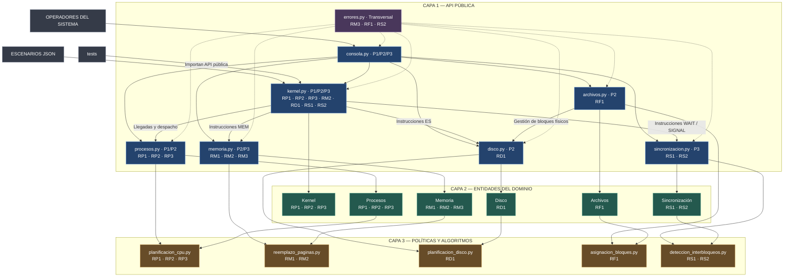
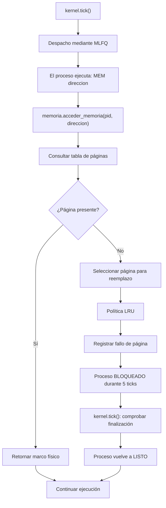

# Diagrama de NimbusDC

Este documento detalla la arquitectura objetivo del proyecto **NimbusDC**, abarcando la estructura por capas, responsabilidades de los módulos, flujo de ejecución y su relación con las fases de los prototipos establecidos.

## 1. Arquitectura General por Capas

El sistema se diseña bajo un modelo de arquitectura de tres capas principales. Esta separación garantiza la modularidad y facilita la sustitución de políticas sin afectar la interfaz pública ni las entidades centrales.



## 2. Responsabilidad de cada capa

### Capa 1: API Pública / Fachada

**Ubicación:** `minidc/*.py`

Esta es la única capa que deben conocer los usuarios del sistema y las pruebas externas. Los módulos de esta capa mantienen las firmas exigidas por el proyecto, validan los parámetros, administran el estado de sus respectivos subsistemas y delegan las operaciones a las entidades y políticas internas.

### Capa 2: Entidades del Dominio

**Ubicación:** `minidc/entidades/`

Aquí se representan los objetos fundamentales que necesita el sistema operativo para funcionar. Estas entidades **no toman decisiones algorítmicas**; su función es representar y conservar la información sobre la que trabajan las políticas.

| Grupo | Entidades principales | Utilización | 
| ----- | ----- | ----- | 
| **Kernel** | Reloj, configuración, eventos de llegada | Control del tiempo y escenarios. | 
| **Procesos** | PCB, TCB, instrucciones y estados | Representación y seguimiento de procesos. | 
| **Memoria** | Espacios de direcciones, tablas de páginas, marcos | Administración de memoria virtual. | 
| **Disco** | Solicitudes, bloques, cabezal y caché | Administración de almacenamiento y E/S. | 
| **Archivos** | Usuarios, inodos, directorios y bloques | Estructura del sistema de archivos. | 
| **Sincronización** | Semáforos, mutex, colas y recursos compartidos | Control de acceso y dependencias. | 

### Capa 3: Políticas y Algoritmos

**Ubicación:** `minidc/politicas/`

Es la capa encargada de tomar las decisiones algorítmicas del sistema. Su separación permite sustituir una política sin modificar las funciones públicas ni las estructuras principales del dominio.

| Política | Algoritmo propuesto | Requisito Medible | 
| ----- | ----- | ----- | 
| **Planificación de CPU** | MLFQ + Aging | RP1, RP2, RP3 | 
| **Reemplazo de páginas** | LRU | RM1, RM2 | 
| **Planificación del disco** | C-SCAN | RD1 | 
| **Asignación de bloques** | Indexada | RF1 | 
| **Detección de interbloqueos** | Grafo de espera + DFS | RS1, RS2 | 

## 3. Conexión de capas durante la ejecución

El componente que coordina el proceso de ejecución es `kernel.py`. El ciclo de ejecución se divide en cuatro fases principales: llegada de procesos, atención de E/S terminada, ejecución de CPU y actualización de métricas.

La relación entre capas se resume en el siguiente cuadro:

| Operación | API pública utilizada | Entidades involucradas | Política aplicada | 
| ----- | ----- | ----- | ----- | 
| **Crear proceso** | `procesos.crear_proceso()` | PCB, estado del proceso | MLFQ | 
| **Planificar CPU** | `procesos.cola_listos()` | PCB, TCB | MLFQ | 
| **Acceder a memoria** | `memoria.acceder_memoria()` | Tabla de páginas, marco físico | LRU | 
| **Fallo de página** | `memoria.acceder_memoria()` | Tabla de páginas, marcos | LRU + Anti-hiperpaginación | 
| **Solicitar E/S** | `disco.encolar_solicitud_disco()` | Solicitud de E/S, cabezal | C-SCAN | 
| **Procesar E/S** | `disco.procesar_disco()` | Solicitudes y bloques | C-SCAN | 
| **Crear un archivo** | `archivos.fs_escribir()` | Inodo, bloques, usuario | Asignación indexada | 
| **Controlar acceso** | `sincronizacion.semaforo_wait()` | Semáforo, cola de espera | Gestión de espera | 
| **Detectar bloqueos** | `sincronizacion.detectar_interbloqueo()` | Mutex, grafo de espera | DFS | 

### Ejemplo: Ejecución de una instrucción `MEM`



De manera análoga:

* **Instrucción ES:** El kernel solicita al módulo de disco que registre una solicitud. La política C-SCAN decide el orden.

* **Instrucción WAIT/SIGNAL:** El kernel utiliza el módulo de sincronización para administrar semáforos y colas.

* **Terminación:** Se liberan marcos de memoria, semáforos y mutex asignados.

## 4. Relación de los módulos con los prototipos

La arquitectura completa está diseñada desde el inicio, pero su implementación es incremental según los hitos del proyecto:

| Capa | Prototipo 1 (Núcleo y Procesos) | Prototipo 2 (Memoria y Almacenamiento) | Prototipo 3 (Sincronización) | 
| ----- | ----- | ----- | ----- | 
| **API Pública** | `kernel`, `procesos`, `consola`, `errores` | `memoria`, `disco`, `archivos` | `sincronizacion` e integración general | 
| **Entidades** | Reloj, eventos, PCB, estados | Páginas, marcos, disco, archivos, TCB | Semáforos, mutex, grafo de espera | 
| **Políticas** | MLFQ | LRU, C-SCAN, Asignación indexada | DFS, mecanismos de sincronización | 

## 5. Decisiones que deben quedar claras en el diseño

Hay cuatro aspectos importantes para que la arquitectura sea consistente:

1. **Las políticas no deben contener las funciones públicas:** Por ejemplo, `politicas/planificacion_cpu.py` debe encargarse de decidir qué proceso ejecutar, pero la función pública `procesos.cola_listos()` debe seguir perteneciendo a `procesos.py`.

2. **Las entidades no deben implementar los algoritmos:** Un PCB almacena la prioridad, el estado y los tiempos del proceso. MLFQ utiliza esos atributos para decidir su ubicación en las colas, pero el PCB por sí mismo no toma esa decisión.

3. **El kernel coordina, no reemplaza a los subsistemas:** `kernel.tick()` determina cuándo se ejecutan los procesos y cuándo se revisan las operaciones pendientes. No debería implementar internamente LRU, C-SCAN ni DFS.

4. **Los requisitos medibles se validan mediante pruebas:** Los códigos que aparecen debajo de cada módulo identifican los requisitos con los que está relacionado. No significan que un módulo, por sí solo, garantice su cumplimiento. Por ejemplo, RP1 depende de la interacción entre el kernel, los PCB y MLFQ.

## Estructura de Directorios

La estructura de carpetas debería mantener esta organización para reflejar las decisiones de diseño:

```text
minidc/
│
├── __init__.py
│
├── kernel.py
├── procesos.py
├── memoria.py
├── disco.py
├── archivos.py
├── sincronizacion.py
├── consola.py
├── errores.py
│
├── entidades/
│   ├── __init__.py
│   ├── proceso.py
│   ├── memoria.py
│   ├── disco.py
│   ├── archivo.py
│   ├── sincronizacion.py
│   └── sistema.py
│
└── politicas/
    ├── __init__.py
    ├── mlfq.py
    ├── reemplazo_paginas.py
    ├── planificacion_disco.py
    ├── asignacion_bloques.py
    └── deteccion_interbloqueos.py
```